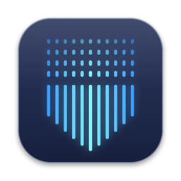
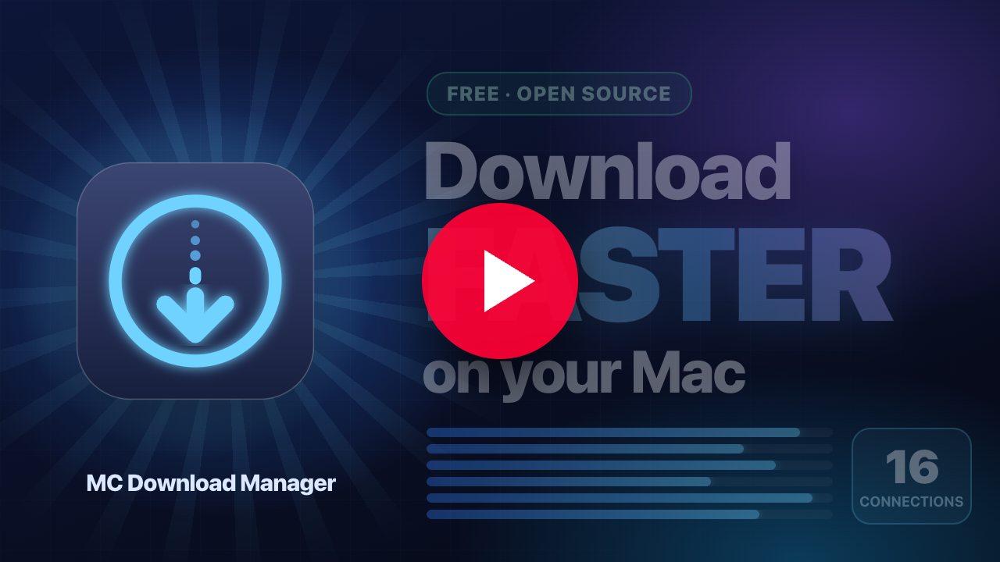
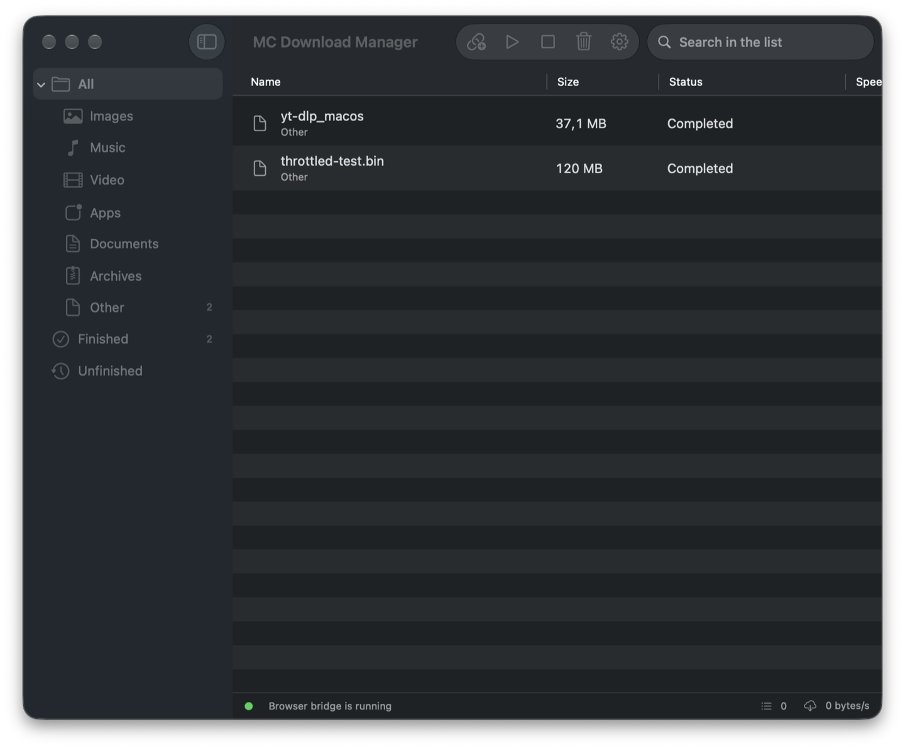
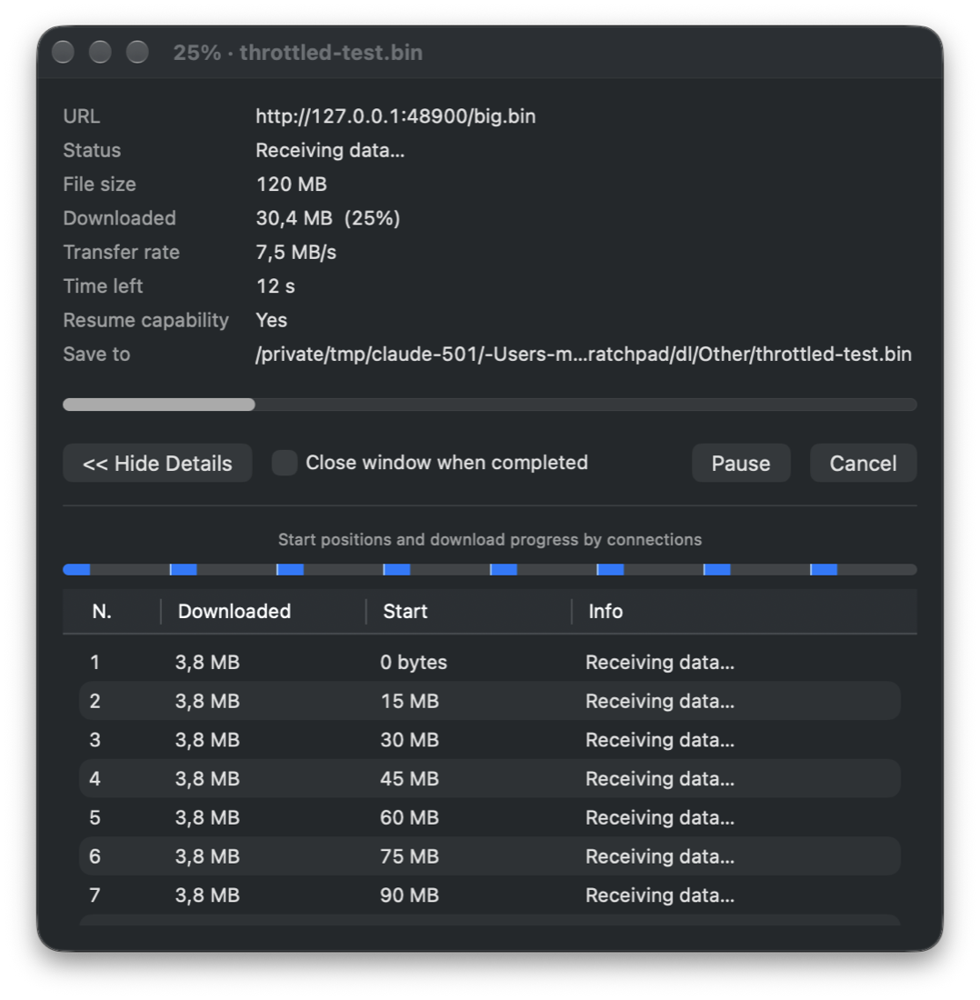

<p align="center">
  
</p>

<h1 align="center">MC Download Manager</h1>

<p align="center">
  A fast, open-source download manager for macOS, with Linux and Windows support in development.<br>
  Captures Safari, Chrome and Firefox downloads, accelerates them with up to 16 parallel connections and downloads videos from web pages.
</p>

<p align="center">
  <a href="README.tr.md">🇹🇷 Türkçe</a> · <a href="https://github.com/EfeDogan/mc-download-manager/releases">Download Linux/Windows</a> · <a href="#installation">Install</a> · <a href="#building-from-source">Build</a>
</p>

<p align="center">
  <a href="https://youtu.be/SsHWR9UFCM0"></a><br>
  <sub>▶ <a href="https://youtu.be/SsHWR9UFCM0">Watch the 1-minute overview</a> · <a href="https://youtu.be/Set5DFC5xmg">Türkçe video</a></sub>
</p>

---

The stable macOS release ships in a single `.app`: the Safari extension, the Chrome and Firefox extensions, `yt-dlp` and `ffmpeg` are bundled.
Open the DMG, drag the app to *Applications*, done. The macOS interface is in **English** and **Turkish** (follows the system language).

> **Platform status:** Linux support has been manually exercised on Ubuntu and
> remains experimental. The Windows installer and Chromium extension have been
> exercised on a real Windows installation. The `preview.3` package adds bundled
> FFmpeg support for direct in-app YouTube URL downloads; that correction has
> been verified on Linux and still needs a real-Windows retest. The feature list
> below describes the mature macOS application; see
> [Current cross-platform scope](CrossPlatform/README.md#current-scope) for the
> Linux and Windows gaps.

## Features

- **Multi-connection downloads** — files are split into HTTP `Range` requests (8 connections by default, 1–16 configurable).
  Falls back to a single stream when the server does not support ranges; adapts the connection count on `429`/`503` throttling.
- **Pause / resume** — segment state is persisted on disk, so downloads continue where they left off even after a restart.
- **Browser integration** — one shared WebExtension for Safari, Google Chrome, Brave and Firefox. A step-by-step setup wizard handles each browser
  one at a time (extension files are placed in `~/Downloads/MC Download Manager/Browser Plugins/`).
  The browser download is cancelled and handed to the app together with cookies, `Referer` and `User-Agent`; captured file types are configurable.
- **Video downloads** — `<video>`, `.m3u8` and `.mpd` streams on the page are detected; "Download video from this page" uses the bundled
  yt-dlp (with ffmpeg merging). Default output is MP4 up to 1080p (container and resolution configurable). Browser cookies are passed to
  yt-dlp, and an in-app sign-in window handles age-restricted videos. yt-dlp can be updated from GitHub with one click.
- **Clipboard** — copy a link and the app asks whether to download it; paste a link into the main window with ⌘V.
- **UI** — sidebar categories (Images, Music, Video, Apps, Documents, Archives…), sortable table, search,
  an IDM-style per-download window (connection table, segment bar, auto-close option), menu-bar item, notifications.
- **Lives in the menu bar** — opens at login (enabled after the first-run setup), starts without a window and without a Dock icon; the browser bridge stays up so extensions never need you to open the app. Closing the window keeps it running; quit from the menu bar icon.

<p align="center">
  <br>
  
</p>

## Installation

### Linux (experimental)

1. Open the [Linux/Windows download page](https://github.com/EfeDogan/mc-download-manager/releases)
   and expand **Assets** under the newest **Cross-platform preview** release.
2. On Ubuntu, Debian, or Linux Mint, download the file ending in `amd64.deb`.
   Double-click it to use the graphical software installer, or install it from
   a terminal:

   ```bash
   sudo apt install ./"MC Download Manager_"*.deb
   ```

3. To run without installing, or to try another distribution, download the file
   ending in `amd64.AppImage`, then run:

   ```bash
   chmod +x "MC Download Manager_"*.AppImage
   ./"MC Download Manager_"*.AppImage
   ```

The AppImage and browser-extension workflow have been manually exercised on
Ubuntu. Other Linux distributions and desktop environments still need broader
testing.

### Windows (experimental)

> **Direct download:**
> [MC.Download.Manager_0.1.0_x64-setup.exe](https://github.com/EfeDogan/mc-download-manager/releases/download/cross-platform-v0.1.0-preview.3/MC.Download.Manager_0.1.0_x64-setup.exe)

1. Open the [Windows download page](https://github.com/EfeDogan/mc-download-manager/releases).
2. Expand **Assets** under the newest **Cross-platform preview** release. Do not
   download the **Source code** archives. Download
   **`MC.Download.Manager_0.1.0_x64-setup.exe`**. The
   `MC.Download.Manager_0.1.0_x64_en-US.msi` file is an alternative;
   `setup.exe` is recommended for most users.
3. Double-click the downloaded `setup.exe` and follow the installer.
4. The package is not code-signed yet. If SmartScreen shows **Windows protected
   your PC**, choose **More info → Run anyway** only if you downloaded the file
   from the Release page linked above.
5. Open **MC Download Manager** from the Start menu. When the upper-right status
   says **Bridge online**, it is ready to accept browser-extension requests.

The Windows installer and Chromium extension have been exercised on a real
Windows installation. The `preview.3` package bundles FFmpeg to support videos
whose audio and picture are supplied as separate streams. That direct in-app
workflow has been verified on Linux and still needs a real-Windows retest. See
[CrossPlatform/README.md](CrossPlatform/README.md) for the current limitations
and source-build steps.

### macOS

**Homebrew**

```bash
brew install --cask mstcvk/tap/mc-download-manager
```

Update with `brew upgrade --cask mc-download-manager`. Then continue with the browser steps (2 and 3) below.

**Manual**

1. Download the DMG from [Releases](https://github.com/mstcvk/mc-download-manager/releases), open it and drag **MC Download Manager.app** to *Applications*.
   - Builds that are not notarized trigger a Gatekeeper warning on first launch: *System Settings ▸ Privacy & Security ▸ "Open Anyway"*.
2. **Safari:** *Safari ▸ Settings ▸ Extensions ▸ MC Download Manager* → enable and allow for all websites.
   - For ad-hoc signed builds Safari also requires *Develop ▸ Allow Unsigned Extensions* (not needed for Developer ID signed builds).
3. **Chrome:** open `chrome://extensions`, turn on *Developer mode*, choose *Load unpacked* and select the folder shown in the app under
   *Settings ▸ Browser ▸ Show Folder* (`ChromeExtension` inside the app bundle).
4. **Firefox:** *Settings ▸ Browser Extensions ▸ Open Setup Wizard… ▸ Add to Firefox*. The add-on is signed by Mozilla and bundled
   with the app; Firefox asks for confirmation once and keeps it installed (Firefox 140 or later).

The app runs a tiny HTTP bridge on `127.0.0.1:48213` that only accepts requests from browser extensions (`Origin` check).

## Linux and Windows usage

1. Start **MC Download Manager** and confirm that the status in the upper-right
   corner says **Bridge online**. Closing the window keeps the application
   running in the system tray; use **Quit** from the tray menu to stop it.
2. To download directly, paste an HTTP(S) URL into the main window. Known video
   sites such as YouTube and X/Twitter are selected as **Video from page**
   automatically. You can also choose the download type manually.
3. Open **Settings** to select the light/dark appearance, color palette, and
   maximum video quality. Video-quality choices range from 360p through 2160p,
   plus **Best available**. The same setting applies to downloads started by the
   browser extensions.
4. Use **Open download folder** to open the current destination without finding
   it manually. By default files are saved under the operating system's Downloads
   directory in `MC Download Manager`.

### Chromium, Chrome, Brave, and Edge

1. Click **Chromium extension** in the desktop application. The application
   copies the unpacked extension into its download directory and displays the
   exact path.
2. Open the browser's extension page (`chrome://extensions` for Chrome/Chromium,
   `brave://extensions` for Brave, or `edge://extensions` for Edge).
3. Enable **Developer mode**, choose **Load unpacked**, and select the displayed
   `ChromiumExtension` directory. If it was already loaded, click **Reload** on
   the extension card after updating the application.
4. Keep the desktop application running. The extension can redirect browser
   downloads, detect media playing in the active tab, or send the current video
   page to yt-dlp.

### Firefox

1. Click **Firefox extension** in the desktop application.
2. Open `about:debugging#/runtime/this-firefox`, choose **Load Temporary Add-on**,
   and select the displayed `FirefoxExtension/manifest.json` file.
3. Keep the desktop application running while downloading.

The cross-platform Firefox extension is currently a temporary development
add-on and is removed when Firefox restarts. Permanent installation requires a
Mozilla-signed XPI, which is not published for these builds yet.

For the highest video resolutions, install `ffmpeg` and make sure it is available
on `PATH`; yt-dlp needs it to merge separate video and audio streams. The packaged
application currently includes yt-dlp but not ffmpeg.

## Building from source

Requirements: macOS 13+, Xcode 15+, [xcodegen](https://github.com/yonaskolb/XcodeGen) (`brew install xcodegen`).

```bash
scripts/fetch-tools.sh   # downloads universal yt-dlp and ffmpeg (arm64 + x86_64) into Tools/
scripts/build.sh         # Release build, code signing and build/MC Download Manager <version>.dmg
```

For development run `xcodegen generate` and open `MCDownloadManager.xcodeproj`.

Developer ID signing and notarization:

```bash
CODESIGN_IDENTITY="Developer ID Application: Your Name (TEAMID)" NOTARY_PROFILE=notary scripts/build.sh
```

The GitHub Actions workflow (`.github/workflows/build.yml`) builds a DMG on every push and attaches it to the release on `v*` tags.

### Linux and Windows development

The experimental cross-platform implementation lives in [`CrossPlatform/`](CrossPlatform/README.md).
It currently provides a Tauri desktop window and tray, the browser-extension
bridge, direct HTTP(S) downloads, page-video downloads through bundled
`yt-dlp`, progress, pause/resume/cancel/remove, and Chromium plus temporary
Firefox extension installation. CI builds Linux
and Windows installers; feature parity with the macOS application
(segmented downloads, persistence, clipboard, notifications, and autostart) is
still in progress.

### Updating the Homebrew cask

After a release's DMG is uploaded, `scripts/update-cask.sh` bumps `Casks/mc-download-manager.rb` in
[mstcvk/homebrew-tap](https://github.com/mstcvk/homebrew-tap) to the version in `project.yml` (checksum taken from the release asset).

### Publishing the Chrome extension to the Web Store

Chrome only installs extensions silently from the Chrome Web Store, so until the extension is published the app guides users through
*Developer mode ▸ Load unpacked*. To publish:

```bash
scripts/pack-extension.sh      # → build/mc-download-manager-chrome-<version>.zip
```

Upload the zip in the [Chrome Web Store developer console](https://chrome.google.com/webstore/devconsole), then set
`BrowserIntegration.chromeWebStoreURL` to the store page; "Install" will open it directly.

### Signing the Firefox add-on

Release Firefox only installs add-ons signed by Mozilla. `scripts/build.sh` runs `scripts/pack-firefox.sh`, which builds the
Firefox variant of the manifest (`background.scripts`, `browser_specific_settings.gecko`) and, when
[AMO API credentials](https://addons.mozilla.org/developers/addon/api/key/) are available, signs it as an unlisted add-on
(once per version) and bundles it as `FirefoxExtension.xpi`. Store the credentials in the login keychain:

```bash
security add-generic-password -s mc-download-manager-amo -a issuer -w 'user:…'
security add-generic-password -s mc-download-manager-amo -a secret -w '…'
```

Without credentials the unsigned add-on is bundled; Firefox can then only load it temporarily via `about:debugging`.

## Project layout

```
App/Sources/DownloadManager/
  Engine/SegmentedDownloader.swift   multi-connection HTTP downloader (URLSession, Range, adaptive concurrency)
  Engine/VideoDownloader.swift       yt-dlp wrapper (progress parsing, cookie file)
  Engine/DownloadStore.swift         queue, persistence, speed measurement
  Engine/ClipboardWatcher.swift      clipboard monitoring and ⌘V handling
  Server/LocalServer.swift           minimal HTTP server on Network.framework
  Server/ServerController.swift      /ping /download /downloads /action endpoints
  Views/                             SwiftUI (main window, download window, settings)
App/Resources/Localizable.xcstrings  English (base) + Turkish strings
SafariExtension/                     Safari Web Extension target (native messaging launches the app)
Extension/                           shared WebExtension (manifest v3, background, content, popup, _locales)
scripts/                             fetch-tools.sh, build.sh, pack-extension.sh, update-cask.sh, make_icons.swift
project.yml                          xcodegen project spec
```

### Bridge API

| Endpoint | Description |
|---|---|
| `GET /ping` | version, yt-dlp availability, active download count |
| `POST /download` | `{url, filename?, referer?, userAgent?, cookieHeader?, cookies?[], kind: "file"\|"video", videoQuality?, segments?}` |
| `GET /downloads` | status of the last 50 downloads |
| `POST /action` | `{id, action: "pause"\|"resume"\|"cancel"\|"remove"}` |

The bridge only answers requests whose `Origin` is a browser-extension origin (`chrome-extension://`, `safari-web-extension://`, `moz-extension://`) and whose `Host` is the loopback address; requests from ordinary web pages (including `Origin: null`) are rejected, and CORS headers are only sent to extension origins.

## Contributing

Issues and pull requests are welcome. Translations live in `App/Resources/Localizable.xcstrings` and `Extension/_locales/`.

## License

The code is licensed under the MIT License (see `LICENSE`). Bundled binaries
keep their own licenses: [yt-dlp](https://github.com/yt-dlp/yt-dlp)
(Unlicense), [Deno](https://github.com/denoland/deno) (MIT), and
[FFmpeg](https://ffmpeg.org) (GPL build from
[yt-dlp/FFmpeg-Builds](https://github.com/yt-dlp/FFmpeg-Builds)). See
[`CrossPlatform/THIRD_PARTY_NOTICES.md`](CrossPlatform/THIRD_PARTY_NOTICES.md)
for the pinned build and corresponding source links.
