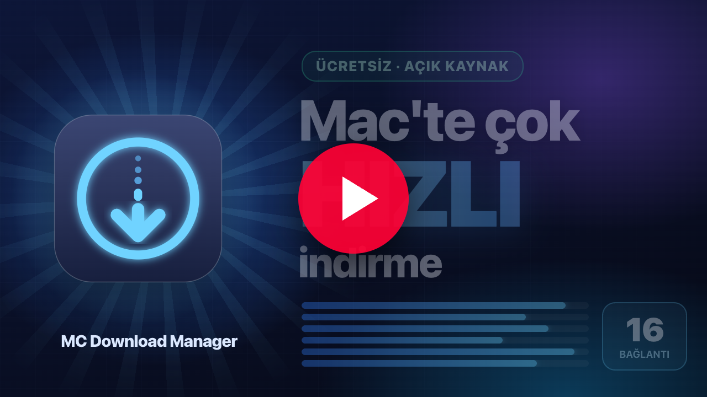
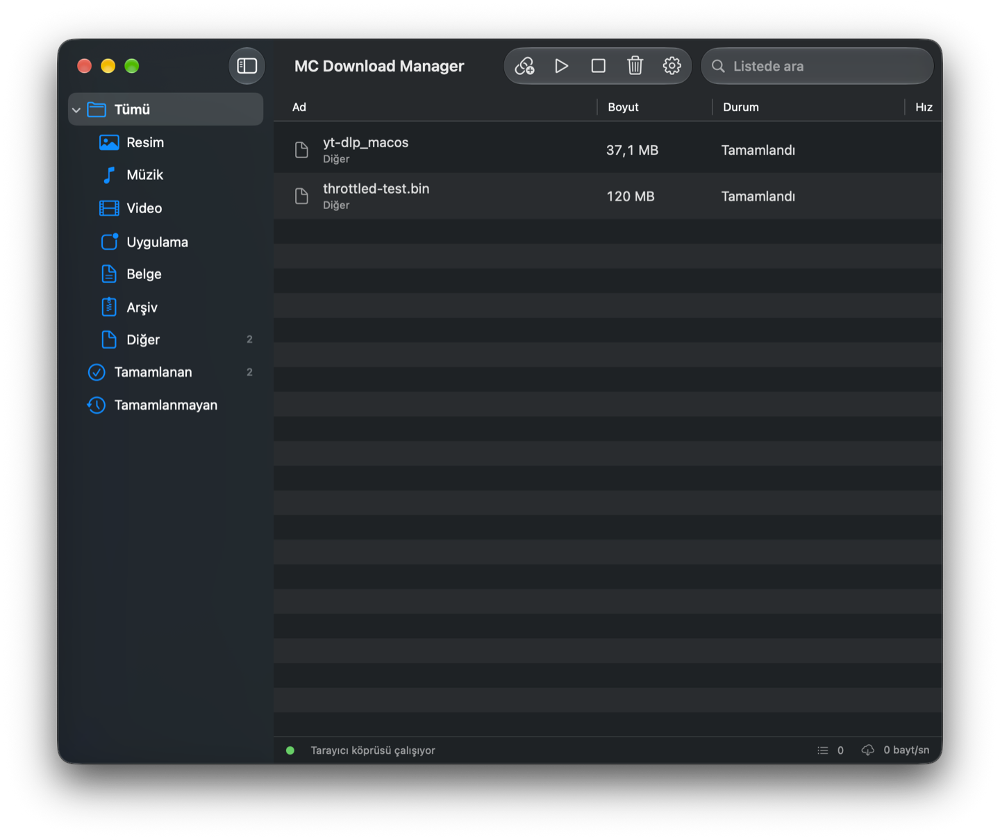

<p align="center">
  
</p>

<h1 align="center">MC Download Manager</h1>

<p align="center">
  macOS için hızlı, açık kaynaklı bir indirme yöneticisi; Linux ve Windows desteği geliştiriliyor.<br>
  Safari, Chrome ve Firefox indirmelerini yakalar, 16'ya kadar paralel bağlantıyla hızlandırır ve sayfalardaki videoları indirir.
</p>

<p align="center">
  <a href="README.md">🇬🇧 English</a> · <a href="https://github.com/EfeDogan/mc-download-manager/releases">Linux/Windows'u indir</a> · <a href="#kurulum">Kurulum</a>
</p>

<p align="center">
  <a href="https://youtu.be/Set5DFC5xmg"></a><br>
  <sub>▶ <a href="https://youtu.be/Set5DFC5xmg">1 dakikalık tanıtımı izleyin</a> · <a href="https://youtu.be/SsHWR9UFCM0">English video</a></sub>
</p>

---

Kararlı macOS sürümünde her şey tek bir `.app` içinde gelir: Safari uzantısı, Chrome ve Firefox eklentileri, `yt-dlp` ve `ffmpeg` uygulamaya gömülüdür.
DMG'yi açıp uygulamayı *Applications* klasörüne sürüklemek yeterlidir. macOS arayüzü **İngilizce** ve **Türkçe**dir (sistem dilini izler).

> **Platform durumu:** Linux desteği Ubuntu üzerinde elle denenmiştir ve hâlâ
> deneyseldir. Windows paketleri CI üzerinde üretilmektedir ancak gerçek bir
> Windows kurulumunda henüz doğrulanmamıştır. Aşağıdaki özellik listesi olgun
> macOS uygulamasını anlatır; Linux ve Windows eksikleri için
> [Güncel çapraz platform kapsamına](CrossPlatform/README.md#current-scope) bakın.

## Özellikler

- **Çok parçalı indirme** — dosya HTTP `Range` isteklerine bölünür (varsayılan 8 bağlantı, 1–16 arası ayarlanabilir).
  Sunucu `Range` desteklemiyorsa tek akışa düşer; `429`/`503` sınırlamalarında bağlantı sayısı adaptif olarak azaltılır.
- **Duraklat / sürdür** — parça durumları diske yazılır; uygulama yeniden açılsa bile kaldığı yerden devam eder.
- **Tarayıcı entegrasyonu** — Safari, Google Chrome, Brave ve Firefox için tek kaynaklı WebExtension. Adım adım kurulum sihirbazı her tarayıcıyı
  tek tek ele alır (eklenti dosyaları `~/Downloads/MC Download Manager/Browser Plugins/` altına yerleştirilir).
  Tarayıcıdaki indirme iptal edilip çerezler, `Referer` ve `User-Agent` ile birlikte uygulamaya iletilir; yakalanan dosya türleri ayarlanabilir.
- **Video indirme** — sayfadaki `<video>`, `.m3u8` ve `.mpd` akışları yakalanır; "Bu sayfadaki videoyu indir" gömülü yt-dlp'yi
  (ffmpeg ile birleştirme dahil) kullanır. Varsayılan çıktı en fazla 1080p MP4'tür (kapsayıcı ve çözünürlük ayarlanabilir). Tarayıcı çerezleri
  yt-dlp'ye aktarılır; yaş doğrulamalı videolar için uygulama içi giriş penceresi vardır. yt-dlp tek tıkla GitHub'dan güncellenebilir.
- **Pano** — bir bağlantı kopyaladığınızda uygulama indirmek isteyip istemediğinizi sorar; ana pencereye ⌘V ile bağlantı yapıştırabilirsiniz.
- **Arayüz** — kenar çubuğunda kategoriler (Resim, Müzik, Video, Uygulama, Belge, Arşiv…), sıralanabilir tablo, arama,
  IDM tarzı dosya özelinde pencere (bağlantı tablosu, parça çubuğu, otomatik kapat seçeneği), menü çubuğu simgesi, bildirimler.
- **Menü çubuğunda yaşar** — oturum açıldığında başlar (ilk kurulumdan sonra otomatik etkinleşir), pencere ve Dock simgesi olmadan açılır; tarayıcı köprüsü hep açık olduğundan eklentiler uygulamayı açmanızı beklemez. Pencereyi kapatmak uygulamayı kapatmaz; çıkmak için menü çubuğu simgesini kullanın.

<p align="center">
  <br>
  
</p>

## Kurulum

### Linux (deneysel)

1. [Linux/Windows indirme sayfasını](https://github.com/EfeDogan/mc-download-manager/releases)
   açın ve en üstteki **Cross-platform preview** sürümünün altındaki
   **Assets** bölümünü genişletin.
2. Ubuntu, Debian veya Linux Mint kullanıyorsanız adı `amd64.deb` ile biten
   dosyayı indirin. Dosyaya çift tıklayıp yazılım yükleyiciyle kurun. Terminalden
   kurmak isterseniz:

   ```bash
   sudo apt install ./"MC Download Manager_"*.deb
   ```

3. Kurulum yapmadan çalıştırmak veya başka bir dağıtım denemek için adı
   `amd64.AppImage` ile biten dosyayı indirin; ardından:

   ```bash
   chmod +x "MC Download Manager_"*.AppImage
   ./"MC Download Manager_"*.AppImage
   ```

AppImage ve tarayıcı eklentisi akışı Ubuntu üzerinde elle denenmiştir. Diğer
Linux dağıtımları ve masaüstü ortamları için daha geniş test gereklidir.

### Windows (deneysel)

1. [Windows indirme sayfasını](https://github.com/EfeDogan/mc-download-manager/releases)
   açın.
2. En üstteki **Cross-platform preview** sürümünün altındaki **Assets** bölümünü
   genişletin. **Source code** dosyalarını değil, adı `x64-setup.exe` ile biten
   Windows kurucusunu indirin. `.msi` dosyası alternatif kurucudur; normal
   kullanıcı için `setup.exe` önerilir.
3. İndirilen `setup.exe` dosyasına çift tıklayın ve kurulum adımlarını izleyin.
4. Paket henüz kod imzalı değildir. SmartScreen **Windows bilgisayarınızı
   korudu** uyarısı gösterirse yalnızca dosyayı yukarıdaki Release sayfasından
   indirdiğinizden eminseniz **Ek bilgi → Yine de çalıştır**ı seçin.
5. Kurulum bitince Başlat menüsünden **MC Download Manager**'ı açın. Sağ üstte
   **Bridge online** göründüğünde uygulama tarayıcı eklentilerini kabul etmeye
   hazırdır.

Windows paketleri CI üzerinde derlenmektedir ancak gerçek bir Windows
kurulumunda henüz doğrulanmamıştır. Güncel sınırlamalar ve kaynaktan derleme
adımları için [CrossPlatform/README.md](CrossPlatform/README.md) dosyasına bakın.

### macOS

**Homebrew**

```bash
brew install --cask mstcvk/tap/mc-download-manager
```

Güncellemek için `brew upgrade --cask mc-download-manager`. Ardından aşağıdaki tarayıcı adımlarıyla (2 ve 3) devam edin.

**Elle kurulum**

1. [Sürümler](https://github.com/mstcvk/mc-download-manager/releases) sayfasından DMG'yi indirin, açın ve **MC Download Manager.app**'i *Applications*'a sürükleyin.
   - Notarize edilmemiş derlemelerde ilk açılışta macOS uyarı verir: *Sistem Ayarları ▸ Gizlilik ve Güvenlik ▸ "Yine de Aç"*.
2. **Safari:** *Safari ▸ Ayarlar ▸ Uzantılar ▸ MC Download Manager* → etkinleştirin ve tüm web sitelerine izin verin.
   - Ad-hoc imzalı derlemelerde Safari ayrıca *Geliştirici ▸ İmzasız uzantılara izin ver* seçeneğini ister (Developer ID ile imzalı sürümlerde gerekmez).
3. **Chrome:** `chrome://extensions` ▸ *Geliştirici modu* ▸ *Paketlenmemiş öğe yükle* ▸ uygulama içindeki
   *Ayarlar ▸ Tarayıcı ▸ "Klasörü Göster"* ile açılan `ChromeExtension` klasörünü seçin.
4. **Firefox:** *Ayarlar ▸ Tarayıcı Eklentileri ▸ Kurulum Sihirbazını Aç… ▸ Firefox'a Ekle*. Eklenti Mozilla tarafından imzalıdır ve
   uygulamayla birlikte gelir; Firefox bir kez onay ister ve eklentiyi kalıcı olarak kurar (Firefox 140 veya üstü).

Uygulama `127.0.0.1:48213` üzerinde yalnızca tarayıcı uzantılarından (`Origin` denetimi) istek kabul eden küçük bir HTTP köprüsü çalıştırır.

## Linux ve Windows'ta kullanım

1. **MC Download Manager**'ı başlatın ve sağ üstte **Bridge online** yazdığını
   doğrulayın. Pencereyi kapatmak uygulamayı kapatmaz; sistem tepsisinde çalışmaya
   devam eder. Tamamen kapatmak için tepsi menüsündeki **Quit** seçeneğini kullanın.
2. Doğrudan indirmek için ana pencereye bir HTTP(S) adresi yapıştırın. YouTube ve
   X/Twitter gibi bilinen video siteleri otomatik olarak **Video from page**
   türüne geçirilir; indirme türünü elle de seçebilirsiniz.
3. Açık/koyu görünüm, renk paleti ve en yüksek video çözünürlüğünü belirlemek için
   **Settings**'i açın. 360p ile 2160p arasında veya **Best available** seçilebilir.
   Bu ayar tarayıcı eklentilerinden başlatılan video indirmelerine de uygulanır.
4. İndirme klasörünü dosya yöneticisinde doğrudan açmak için
   **Open download folder** düğmesini kullanın. Dosyalar varsayılan olarak işletim
   sisteminin İndirilenler klasöründeki `MC Download Manager` altına kaydedilir.

### Chromium, Chrome, Brave ve Edge

1. Masaüstü uygulamasındaki **Chromium extension** düğmesine basın. Uygulama,
   paketlenmemiş eklentiyi indirme klasörüne kopyalar ve tam yolu gösterir.
2. Tarayıcının eklenti sayfasını açın: Chrome/Chromium için
   `chrome://extensions`, Brave için `brave://extensions`, Edge için
   `edge://extensions`.
3. **Geliştirici modu**nu etkinleştirin, **Paketlenmemiş öğe yükle**yi seçin ve
   gösterilen `ChromiumExtension` klasörünü açın. Eklenti önceden yüklüyse
   uygulamayı güncelledikten sonra eklenti kartındaki **Yeniden yükle**ye basın.
4. Masaüstü uygulamasını çalışır durumda bırakın. Eklenti tarayıcı indirmelerini
   uygulamaya yönlendirebilir, etkin sekmede oynayan medyayı algılayabilir ve
   açık video sayfasını yt-dlp'ye gönderebilir.

### Firefox

1. Masaüstü uygulamasındaki **Firefox extension** düğmesine basın.
2. `about:debugging#/runtime/this-firefox` sayfasını açın,
   **Geçici Eklenti Yükle**yi seçin ve gösterilen
   `FirefoxExtension/manifest.json` dosyasını açın.
3. İndirme sırasında masaüstü uygulamasını çalışır durumda bırakın.

Çapraz platform Firefox eklentisi şimdilik geçici bir geliştirme eklentisidir ve
Firefox yeniden başladığında kaldırılır. Kalıcı kurulum için Mozilla imzalı XPI
gerekir; bu paketler için henüz yayımlanmamaktadır.

En yüksek video çözünürlükleri için `ffmpeg` kurulu ve `PATH` üzerinde erişilebilir
olmalıdır; yt-dlp ayrı video ve ses akışlarını birleştirmek için ffmpeg kullanır.
Paketli uygulama şu anda yt-dlp'yi içerir ancak ffmpeg'i içermez.

## Kaynaktan derleme

Gereksinimler: macOS 13+, Xcode 15+, [xcodegen](https://github.com/yonaskolb/XcodeGen) (`brew install xcodegen`).

```bash
scripts/fetch-tools.sh   # universal yt-dlp ve ffmpeg (arm64 + x86_64) ikililerini Tools/ içine indirir
scripts/build.sh         # Release derler, imzalar ve build/MC Download Manager <sürüm>.dmg üretir
```

Geliştirme için `xcodegen generate` çalıştırıp `MCDownloadManager.xcodeproj`'yi Xcode'da açın.

Developer ID ile imzalama ve notarizasyon:

```bash
CODESIGN_IDENTITY="Developer ID Application: Ad Soyad (TEAMID)" NOTARY_PROFILE=notary scripts/build.sh
```

GitHub Actions iş akışı (`.github/workflows/build.yml`) her push'ta DMG üretir ve `v*` etiketlerinde Release'e ekler.

### Linux ve Windows geliştirmesi

Deneysel çapraz platform uygulaması [`CrossPlatform/`](CrossPlatform/README.md)
altındadır. Şu anda Tauri masaüstü penceresi ve sistem tepsisi, tarayıcı
eklentisi köprüsü, doğrudan HTTP(S) indirmeleri, uygulamayla paketlenen
`yt-dlp` üzerinden sayfa videosu indirme, ilerleme ve
duraklat/sürdür/iptal et/kaldır işlevleri ile Chromium ve geçici Firefox
eklenti kurulumu çalışmaktadır. CI, Linux ve Windows
kurulum paketlerini üretir; macOS uygulamasındaki çok parçalı indirme, kalıcılık,
pano, bildirim ve otomatik başlatma özellikleri henüz tamamlanmamıştır.

### Homebrew cask'ini güncelleme

Bir sürümün DMG'si yüklendikten sonra `scripts/update-cask.sh`, [mstcvk/homebrew-tap](https://github.com/mstcvk/homebrew-tap) içindeki
`Casks/mc-download-manager.rb` dosyasını `project.yml`'deki sürüme getirir (sağlama toplamı sürüm dosyasından alınır).

### Chrome eklentisini Web Store'da yayınlama

Chrome, eklentileri yalnızca Chrome Web Store'dan sessizce kurar; eklenti yayınlanana kadar uygulama kullanıcıyı
*Geliştirici modu ▸ Paketlenmemiş öğe yükle* adımlarıyla yönlendirir. Yayınlamak için:

```bash
scripts/pack-extension.sh      # → build/mc-download-manager-chrome-<sürüm>.zip
```

Zip'i [Chrome Web Store geliştirici konsoluna](https://chrome.google.com/webstore/devconsole) yükleyin, ardından
`BrowserIntegration.chromeWebStoreURL` değerini mağaza sayfası yapın; "Kur" doğrudan mağazayı açar.

### Firefox eklentisini imzalama

Firefox'un normal sürümü yalnızca Mozilla tarafından imzalanmış eklentileri kurar. `scripts/build.sh`, `scripts/pack-firefox.sh`
betiğini çalıştırır: bu betik manifest'in Firefox sürümünü (`background.scripts`, `browser_specific_settings.gecko`) üretir ve
[AMO API anahtarları](https://addons.mozilla.org/developers/addon/api/key/) varsa eklentiyi listelenmemiş (unlisted) olarak
imzalatıp (her sürüm için bir kez) `FirefoxExtension.xpi` adıyla uygulamaya ekler. Anahtarları anahtar zincirine kaydedin:

```bash
security add-generic-password -s mc-download-manager-amo -a issuer -w 'user:…'
security add-generic-password -s mc-download-manager-amo -a secret -w '…'
```

Anahtar yoksa imzasız eklenti eklenir; Firefox onu yalnızca `about:debugging` üzerinden geçici olarak yükleyebilir.

## Köprü API'si

| Uç nokta | Açıklama |
|---|---|
| `GET /ping` | sürüm, yt-dlp durumu, aktif indirme sayısı |
| `POST /download` | `{url, filename?, referer?, userAgent?, cookieHeader?, cookies?[], kind: "file"\|"video", videoQuality?, segments?}` |
| `GET /downloads` | son 50 indirmenin durumu |
| `POST /action` | `{id, action: "pause"\|"resume"\|"cancel"\|"remove"}` |

Köprü yalnızca `Origin` değeri tarayıcı eklentisi kaynağı olan (`chrome-extension://`, `safari-web-extension://`, `moz-extension://`) ve `Host` değeri yerel adres olan isteklere yanıt verir; sıradan web sayfalarından gelen istekler (`Origin: null` dahil) reddedilir, CORS başlıkları yalnızca eklenti kaynaklarına gönderilir.

## Katkı

Issue ve pull request'ler memnuniyetle karşılanır. Çeviriler `App/Resources/Localizable.xcstrings` ve `Extension/_locales/` içindedir.

## Lisans

Kod MIT lisanslıdır (bkz. `LICENSE`). Gömülü ikililer kendi lisanslarına tabidir:
[yt-dlp](https://github.com/yt-dlp/yt-dlp) (Unlicense) ve [FFmpeg](https://ffmpeg.org) (martin-riedl.de statik derlemesi, GPL).
GPL'li ffmpeg ikilisi ile dağıtım yapıyorsanız kaynak erişimi yükümlülüğünü göz önünde bulundurun ya da `scripts/fetch-tools.sh` içindeki URL'yi LGPL bir derlemeyle değiştirin.
